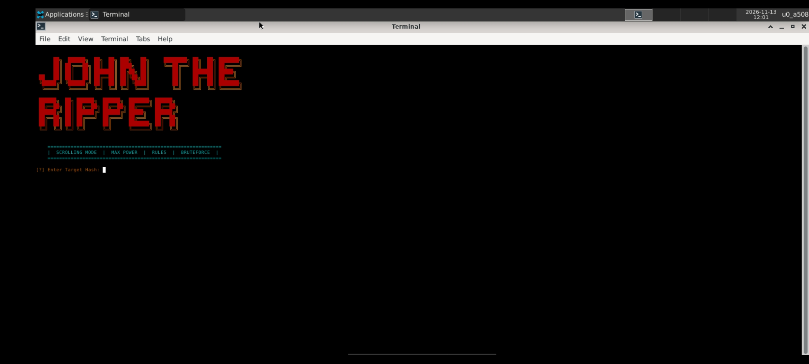

# John The Ripper (Python CLI Edition) 🔐

A high-performance, multi-processed Python CLI password recovery and hash cracking utility inspired by John the Ripper. Built with cross-platform compatibility for **Windows**, **Kali Linux**, **Linux**, and **Termux**, featuring support for multiple hash algorithms, rule-based word mangling, dictionary attacks, and brute-force capabilities.

---

## 📸 Screenshots & Preview

### Interface & Banner

### Hash Cracking Execution

---

## 💻 Supported Platforms

- **Windows** (Windows 10 / 11 via Command Prompt or PowerShell)
- **Kali Linux** (Full terminal support)
- **Linux** (Ubuntu, Debian, Arch, Fedora, etc.)
- **Termux** (Android terminal environment)

---

## ✨ Features & Capabilities

- ⚡ **Multi-Core Processing**: Utilizes Python `multiprocessing` to maximize CPU performance during hash cracking.
- 🔍 **Supported Hash Algorithms**: Auto-detects and verifies `MD5`, `SHA1`, `SHA256`, `SHA512`, `NTLM`, `MD5crypt ($1$)`, `SHA256crypt ($5$)`, `SHA512crypt ($6$)`, and `APR1 ($apr1$)`.
- 🛠️ **Rule-Based Word Mangling**: Automatically generates password mutations using leet-speak transformations, common prefixes, suffixes, and year combinations.
- 📖 **Dictionary & Brute-Force Modes**: Supports custom wordlists as well as raw character-set brute-forcing.
- 🎨 **Interactive CLI Dashboard**: Styled terminal interface powered by `cfonts` and `colorama`.

---

## ⚙️ Requirements & Dependencies

Ensure you have **Python 3.x** installed on your system.

Install the required packages using `requirements.txt`:

    pip install -r requirements.txt

Or install them manually:

    pip install python-cfonts colorama

---

## 🚀 Installation & How to Run

### 🐧 Kali Linux & Standard Linux

    sudo apt update && sudo apt install git python3 python3-pip -y
    git clone https://github.com/johnpaulnunez333-cloud/john-the-ripper.git
    cd john-the-ripper
    pip install -r requirements.txt
    python3 john_cli_en.py

### 📱 Termux (Android)

    pkg update && pkg upgrade -y
    pkg install git python -y
    git clone https://github.com/johnpaulnunez333-cloud/john-the-ripper.git
    cd john-the-ripper
    pip install -r requirements.txt
    python john_cli_en.py

### 🪟 Windows (CMD / PowerShell)

    git clone https://github.com/johnpaulnunez333-cloud/john-the-ripper.git
    cd john-the-ripper
    pip install -r requirements.txt
    python john_cli_en.py

---

## ⚠️ Disclaimer

This tool is developed strictly for **Educational Purposes**, **Security Auditing**, and **Authorized Password Recovery**. The author is not responsible for any misuse or unauthorized activities performed with this software.
