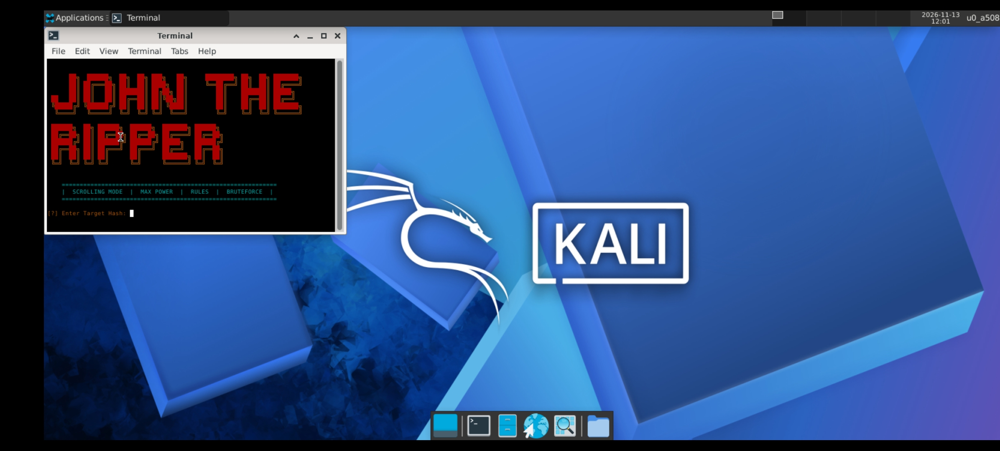

# John The Ripper (Python CLI Edition) 🔐

A high-performance, multi-processed Python CLI password recovery and hash cracking utility inspired by John the Ripper. Built with support for multiple hash algorithms, rule-based word mangling, dictionary attacks, and brute-force capabilities[span_4](start_span)[span_4](end_span).

---

## 📸 Screenshots & Preview

### Interface & Banner

### Hash Cracking Execution

---

## ✨ Features & Capabilities

- ⚡ **Multi-Core Processing**: Utilizes Python `multiprocessing` to maximize CPU performance during hash cracking[span_5](start_span)[span_5](end_span).
- 🔍 **Supported Hash Algorithms**: Auto-detects and verifies `MD5`, `SHA1`, `SHA256`, `SHA512`, `NTLM`, `MD5crypt ($1$)`, `SHA256crypt ($5$)`, `SHA512crypt ($6$)`, and `APR1 ($apr1$)`[span_6](start_span)[span_6](end_span).
- 🛠️ **Rule-Based Word Mangling**: Automatically generates password mutations using leet-speak transformations, common prefixes, suffixes, and year combinations[span_7](start_span)[span_7](end_span).
- 📖 **Dictionary & Brute-Force Modes**: Supports custom wordlists as well as raw character-set brute-forcing[span_8](start_span)[span_8](end_span).
- 🎨 **Interactive CLI Dashboard**: Styled terminal interface powered by `cfonts` and `colorama`[span_9](start_span)[span_9](end_span).

---

## ⚙️ Requirements & Dependencies

Ensure you have **Python 3.x** installed on your system.

Install the required packages using `requirements.txt`:

`pip install -r requirements.txt`

Or install them manually:

`pip install python-cfonts colorama`

---

## 🚀 Installation & How to Run

1. **Clone the Repository:**
   `git clone https://github.com/johnpaulnunez333-cloud/john-the-ripper.git`

2. **Navigate to the Directory:**
   `cd john-the-ripper`

3. **Install Dependencies:**
   `pip install -r requirements.txt`

4. **Run the Tool:**
   `python john_cli_en.py`

---

## ⚠️ Disclaimer

This tool is developed strictly for **Educational Purposes**, **Security Auditing**, and **Authorized Password Recovery**. The author is not responsible for any misuse or unauthorized activities performed with this software.
